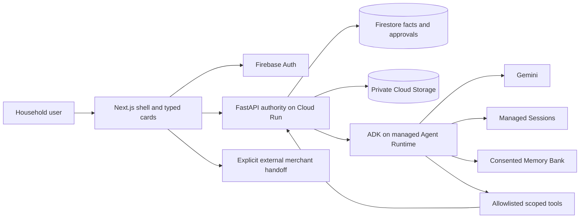
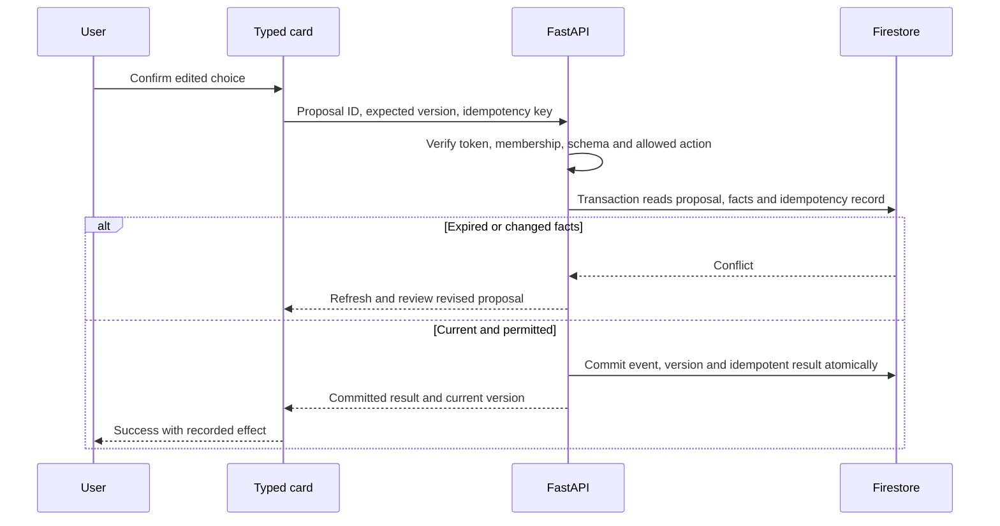

# EcoLoop household MVP — consolidated product and technical specification

Version 1.1 · 16 October 2026 · Status: current product contract; local demo and backend foundation implemented, managed cloud integration pending.

Implementation evidence: [demo acceptance record](../evidence/demo-2026-10-16/README.md) and [parallel execution](PARALLEL_EXECUTION.md). Browser demo data is synthetic and isolated; scripted Ask responses are not Gemini. The requirements below still govern the complete cloud product.

This document replaces the broad sustainability platform blueprint for the current release. It brings product, user journeys, screen behavior, architecture and low-level contracts into one coding-agent entrypoint. The companion [implementation plan](IMPLEMENTATION_PLAN.md) owns decomposition; the live Sheet owns execution status. No cloud, partner, safety or performance capability is claimed as implemented.

## 1. Product and scope

### Product promise

Help an individual or household decide what to cook, check before buying, and share usable food before it becomes waste. Keep the effort of maintaining food information lower than the value of the next useful decision. Sustainability follows from recorded actions and honest observations; it is not a dashboard of invented savings.

The initial user is a busy adult who shops and cooks irregularly, sometimes changes dinner plans, and has incomplete knowledge of the kitchen. Solo use must work immediately. Optional household coordination is an extension, not an onboarding requirement. A member manually states how many people are eating; the product does not infer attendance from private activity.

### Current release boundary

| Included in the household MVP | Deferred from this release |
|---|---|
| Four destinations: Home, Kitchen, Ask, Shop | Corporate kitchens, institutional operations, waste-processor portals |
| Manual/text/photo capture, review and explicit confirmation | Video intake, automatic pantry surveillance, complete offline synchronization |
| Confirmed stock observations with uncertain dates/amounts | Receipt/order history ingestion without actual partner rights |
| Real Gemini with ADK, managed Sessions, consented Memory Bank | Multi-agent marketplace, policy-RAG infrastructure, model tuning |
| Typed meal, adjustment, buy-check and action cards | Arbitrary model-generated interfaces or A2UI package dependency |
| Use-soon, store/use/share/discard outcome recording | Autonomous checkout, purchases, dispatch or recipient allocation |
| Manual shopping list and honest outbound handoff | Claimed live prices, connected account sync, verified merchant inventory |
| Household sharing and a clearly simulated community-interest path | Operational NGO/care-recipient food redistribution |
| Activity history and known quantities with provenance | Automatic carbon/water/money savings or an eco score |

### Approved recovery-pilot overlay — 18 October 2026

The owner has promoted one deliberately isolated exception from the deferred queue for the hackathon deployment: a **demo-only household-surplus and NGO collection-planning pilot** in project `ecoloop-511918`. This does not authorize real recipient operations, food-safety certification, reservation, dispatch, pickup, delivery or autonomous stock mutation.

- A household may submit bounded text, one image or one recorded audio clip. A dedicated Surplus Intake Agent returns a typed candidate only. The household reviews and explicitly confirms the item, amount/unit, pickup location and `available_until` before FastAPI creates a canonical surplus record.
- Plate leftovers, spoiled food, expired food and any item marked unsafe or uncertain for sharing are ineligible. Prepared food remains demo-only and requires qualified human review, temperature evidence and recipient capacity before any future real use.
- A separately authenticated, server-allowlisted demo NGO account may view confirmed eligible demo submissions on a centralized `/ngo` screen. Household users see only their own submissions on `/surplus`.
- The NGO enters the requested food/category, quantity/unit and starting location. A separate Collection Planning Agent may read a bounded eligible snapshot and propose up to ten pickup stops. The number of stops depends on the request; unmet quantity must remain explicit.
- Route distance, duration, ordering and geometry come only from the Google Maps Routes API. The agent may explain a proposal but cannot invent route facts, reserve supply, dispatch anyone or mark collection complete. Both views label the plan as a proposal; the allowlisted NGO renders the full route, while a household receives only its own pickup point and proposal status so other precise locations are not disclosed.
- Temporary image/audio bytes are private and deleted after processing. The two agents are independently deployable on Google Agent Runtime, use the latest stable supported Gemini Flash-class model selected during deployment verification, have no cross-session memory, and expose only narrow read-only tools. Firebase identity, NGO role, membership, version, idempotency and every canonical mutation remain deterministic FastAPI responsibilities.

This overlay supersedes only the earlier blanket deferral of a matching engine and NGO screen. The operational/legal/safety deferral remains in force. The existing household four-destination release and its acceptance requirements remain unchanged.

All ten supplied Stitch screens remain represented, through four pages plus shared flows and sheets. The pilot adds two secondary destinations rather than changing the four-tab household navigation. Scope reduction otherwise continues to exclude broad operator products and speculative automation. It does not remove the latest agreed managed memory or interactive-card requirements.

### Success and product learning

The release succeeds when a user completes one honest loop: capture → correct → confirm → ask → approve a useful change → record what happened. A second session must show a consented preference without treating old stock as current truth. A user can inspect and delete that preference.

Targets to validate, not measured results: time to first confirmed food item ≤2 minutes; core shell usable within 2 seconds on a representative mobile connection; ordinary assistant response within 10 seconds at p95 on the selected deployment. Expose progress/cancel/retry if slower. Record sample size, device, network, model and errors before making performance claims.

Learning metrics: activation rate with a defined eligible-session denominator; capture correction/abandonment; proportion of suggestions accepted; approved action-to-outcome conversion; stale-stock corrections; user-rated usefulness. A suggested meal is not consumed food; a share offer is not a handover. Monetization and organic/merchant promotion wait until usefulness is observed. Organic is an explicit preference, not proof of lower environmental impact.

## 2. Design authority and screen map

Use the user-supplied HTML/PNG pairs under [prototypes](../prototypes/) as visual authority. Preserve those canonical files unchanged. The [Stitch audit](../replan/STITCH_AUDIT.md) records discrepancies and copy corrections.

Warm light surfaces, deep forest green, restrained terracotta, Plus Jakarta Sans, rounded cards and generous spacing are the baseline. Initial token values from the exported frontmatter/code: surface `#f3fbf6`, primary `#143529`, primary container `#2b4c3f`, secondary `#994529`, text `#151d1a`; cards approximately 24px radius. Match each screen when tokens disagree, then consolidate once in implementation. Test contrast; do not inherit an unverified AAA claim. Do not introduce dark-first enterprise styling. A dark variant requires its own design later.

### Shared frontend foundation

Use `frontend/src/components/ui/` for app-wide primitives (`Button`, `Heading`, `Input`, `Card`, and other stable controls) and `frontend/src/components/layout/` for the four-tab shell, navigation, page frame and shared responsive layout. Feature-specific composition remains close to its route. Build mobile-first from the supplied 360px Stitch screens, then expand at wider breakpoints; shared controls retain ≥44px hit areas, labels, visible focus and keyboard behavior.

The scaffold currently uses Tailwind CSS v4. Its CSS-first `@theme` block in `frontend/src/app/globals.css` is the single theme-token source. Define semantic color, type, radius, spacing and elevation tokens there and consume them through generated Tailwind utilities. Do not maintain a duplicate raw-color palette in components or introduce a competing legacy `tailwind.config` token table. A theme color revision should normally be a one-file token change followed by visual review of all four destinations. If Tailwind is deliberately downgraded, record that decision and move the single token source to the matching config format.

### Verification policy

Per current user instruction, do not add or run frontend or backend unit tests, test files/frameworks, or unit-test dependencies. Verification uses requested lint/type/build checks, explicit contract and integration checks, security-boundary exercises, cloud health/smoke checks, manual accessibility review and end-to-end user-journey evidence. Gemini/Google Cloud model evaluations may support quality review when data, cost and expected results are bounded; they do not replace deterministic checks for authorization, arithmetic, versions, idempotency or safety rules. Never claim verification without recording observed evidence.

The generic DESIGN.md prose contains unrelated Shop/Loop/Impact/Bag navigation and a second palette. Actual household screens and the latest consumer four-tab structure take precedence. Use “Shop” as the visible tab label; “Shopping” may describe the feature in prose.

| Stitch export folder | Proposed route/state | Primary behavior and correction |
|---|---|---|
| `ecoloop_household_food_assistant_home` | `/` Home | Next useful action, use-soon items, Ask shortcuts; remove fabricated zero-waste/health/impact assertions |
| `ecoloop_add_food_smart_capture` | shared Add food flow | Camera/upload/manual choice; permission denied and manual fallback |
| `ecoloop_review_detected_food_items` | capture review sheet | Edit names, quantities, date type and uncertainty; confirm once |
| `ecoloop_my_kitchen_inventory` | `/kitchen` | Search, filter, edit and mark an observed outcome; old observations shown as stale |
| `ecoloop_ask_ecoloop_assistant` | `/ask` | Contextual conversation with fixed typed action cards |
| `ecoloop_ask_ecoloop_shopping_decision` | Ask buy-check state | Check confirmed/stale/unknown stock before adding a list item |
| `ecoloop_use_soon_food_action` | item detail/action sheet | Check item, cook, store, share or discard; no AI safety certification |
| `ecoloop_share_before_waste` | share sheet | Household handover record; community interest simulated, no delivery promise |
| `ecoloop_smart_shopping_connected_services` | `/shop` | Editable list, stock check, optional external link; replace fake connection/live-price labels |
| `ecoloop_your_circular_impact` | `/activity` secondary view | Recorded activities, known amounts and unknowns; no invented carbon or double counting |

Capture and use-soon flows are reusable from Home, Kitchen and Ask. Progress is accessible from Home/profile; it is not a fifth primary tab. Settings/memory controls live in profile. Onboarding is a few skippable states, not a separate feature suite.

Every screen needs loading, empty, error and populated states; mutation controls also need pending, conflict, retry and success states. Preserve form input after recoverable failure. Minimum 44px targets, readable 360px layouts, keyboard operation, labeled icon buttons and visible focus are acceptance conditions. Do not copy export HTML blindly: it contains static placeholders and external fonts/assets.

## 3. User journeys and service behavior

### J1 — First useful decision, solo

1. Open Home. Explain the benefit in one sentence. “Try demo” uses explicitly synthetic, isolated data; signing in establishes a personal household without invitations.
2. Skip preferences or select a few. Optional “Remember this preference” is a separate, unchecked choice with an explanation and later deletion controls.
3. Add food manually, by text or by photo. Request camera permission only on capture. Show processing, cancel and manual fallback.
4. Review detected candidates. Correct a mislabeled item, quantity, unit or date. Unknown is a valid answer. Show that nothing is saved until confirmation.
5. Confirm. A single server transaction writes the selected facts and returns the current version. Repeated submission returns the same result.
6. Ask “What can I make tonight?” A meal card states which observations it used and asks about uncertain stock. Approval records a plan; it does not decrement ingredients.
7. Later, record “used” with an actual or approximate amount, or “not yet.” Update stock only from the user's confirmed outcome. Activity reflects the recorded event.

Recovery: a parse failure preserves the upload reference and offers manual entry; a conflict reloads current facts without discarding corrections; an unsigned user cannot write into an authenticated household.

### J2 — Dinner changes from four people to two

1. From Ask or Home, enter the changed count and current preparation stage: not started / partly prepared / already cooked / unknown.
2. Deterministic scaling uses the confirmed original servings and compatible ingredient units. The model explains choices and alternatives. No universal cooking cutoff is invented.
3. Before preparation, propose a smaller batch. After preparation, propose storage or sharing options subject to human checks; never pretend already cooked food can be uncooked.
4. Show a portion-adjustment card, quantities, uncertainty and proposed changes. User explicitly accepts or edits.
5. Record the plan revision. Follow up with a lightweight outcome prompt; do not infer consumption or waste avoided.

If counts or quantities are missing, ask for that field or return qualitative suggestions. A stale card cannot overwrite a newer dinner plan.

### J3 — Share before waste

1. Home/Kitchen surfaces a confirmed date reminder or a “last checked” prompt. Unknown produce age is not a use-by date.
2. User checks the item and chooses use/store/share/discard. Sharing is offered while useful, before a waste route.
3. MVP sharing is an owner-recorded private handover log: the signed-in owner records an intended recipient label, approximate amount and note, without another user account, invitations or a public offer. No recipient contact/address is published. Future collaborative acceptance requires explicit membership/visibility work before it is enabled.
4. Separate offered → accepted → handed over → cancelled/expired as owner-reported states, labeled as such; acceptance is not recipient-verified in this release. Only an owner-confirmed handover records an outgoing quantity. Acceptance alone cannot create impact.
5. Community/care-recipient interest is a labeled simulation or request for qualified review. No plate leftovers, spoiled food or expired food can be routed to recipients. Unserved prepared food requires a qualified human eligibility review, temperature evidence and recipient capacity before any future real operation.
6. Discard/compost records the user's actual route. Compost suitability depends on local collection/process rules; uncertain guidance remains uncertain.

MVP has no public feed, matching engine, dispatch or promise of eligibility. This preserves the sharing idea without implying operational food redistribution.

The approved recovery-pilot overlay adds an authenticated, allowlisted demo matching screen outside this private handover flow. It operates only on separately confirmed surplus submissions, produces proposals rather than allocations, and does not change the owner-reported handover semantics above.

### J3A — Demo surplus intake and NGO collection proposal

1. A signed-in household chooses text, image or recorded audio, then submits a bounded input for extraction. The intake agent returns editable candidate fields and explicit unknowns; no canonical surplus exists yet.
2. The household checks the food itself, corrects the item and quantity/unit, confirms the pickup location and `available_until`, accepts the demo-only disclosure, and explicitly creates the surplus record. Prohibited or stale categories are rejected deterministically.
3. The household can see only its own confirmed submissions, availability state and any current route proposal that includes that submission. No proposal means reserved or collected.
4. A separately signed-in, server-allowlisted demo NGO enters food/category, amount/unit and starting location. The backend supplies only confirmed, unexpired, eligible records with compatible units to the planning agent.
5. The planning agent returns a typed candidate selection of at most ten stops. Deterministic backend validation enforces eligibility, quantity compatibility and request freshness; Google Maps Routes supplies the route facts and polyline.
6. The NGO reviews the full map, ordered stops, offered total and unmet amount. A household sees the same proposal ID and status plus only its own pickup point; other stops, NGO origin and route geometry are redacted at the API boundary. No action dispatches, reserves or mutates stock in this pilot.

### J4 — Check before buying

1. Add an item to Shop or ask “Should I buy tomatoes?” Read relevant confirmed observations with timestamps.
2. If stock is stale or uncertain, ask “Do you still have these?” rather than block the purchase or fabricate a precise balance.
3. Offer edit quantity, skip, substitute, or add to shopping list through a typed card. Organic can be a user preference when available.
4. An explicitly labeled external link opens a merchant app/site. A mock cart is labeled simulated. No purchase, account link, live price or completed order is claimed.
5. The user later confirms a receipt or purchase manually. A click, list item or order observation never silently becomes pantry stock.

### J5 — Remember a preference, safely

1. User opts to remember a reusable preference such as “prefer vegetarian weekday dinners.” Preview the exact proposed preference.
2. The backend stores consent and submits only approved preference content for managed memory. No automatic full-session ingestion.
3. In a distinct new managed session, retrieve only that user's application-scoped approved preferences. Confirmed stock is independently fetched from Firestore.
4. “Why this?” distinguishes a saved preference from today's kitchen facts. User can edit/delete the preference and revoke future generation.
5. Retrieval excludes revoked entries immediately using a consent/version filter, including while provider deletion is pending. Show pending deletion honestly; verify provider deletion before claiming permanent deletion.

## 4. High-level architecture

### Boundaries and deployment

Next.js App Router on Firebase App Hosting supplies the deterministic shell and fixed React cards. Firebase Auth establishes identity. FastAPI on Cloud Run verifies tokens, resolves household membership, validates commands and owns canonical mutations. One Google ADK orchestrator uses real Gemini on the preferred managed Agent Platform Runtime, managed Sessions and Memory Bank. Firestore owns authoritative household facts; Cloud Storage holds private intake media with bounded retention. Do not introduce additional services for each screen.

This diagram is a proposed deployment, not a deployed topology. The agent-to-tool authority seam carries a server-signed context bound to user/household/session and narrowly scoped commands; never a model-supplied tenant ID or a broadly privileged public endpoint. Limit recursion: tool requests execute a domain command/read and cannot start another assistant turn.

### State ownership

| State | Authority | Rule |
|---|---|---|
| Food candidates | Temporary intake record | No canonical write until explicit confirmation |
| Stock, dates, lists, plans, outcomes | Firestore | Versioned human-confirmed facts and events |
| Turn history and session context | Managed Sessions | Private user scope, retention policy; not stock authority |
| Reusable preferences | Consented Memory Bank + consent ledger | Approved preference content only; no automatic raw transcripts |
| Pending/approved actions | Firestore | Bound actor, scope, snapshot version, expiry and idempotency |
| Photos/receipts | Private Cloud Storage | Scoped signed upload/read; explicit expiry/deletion policy |
| Task completion | MVPTasks in existing live Sheet | Local Markdown/JSON are snapshots, no automatic sync |

One backend with focused domain modules is preferable to microservices for this scope. Suggested modules are identity/scope, intake, kitchen, assistant, actions, shopping, preferences and activity; this is a responsibility map, not a mandate for eight deployments.

## 5. Low-level domain contracts

All names below are proposed contracts to freeze in M0, not existing endpoints. Use strict schema versions and reject unexpected fields on commands. Store timestamps in UTC, display in the user's timezone, and preserve a date-only label without shifting it across timezone boundaries.

### Records and invariants

| Record | Minimum fields |
|---|---|
| Household/member | opaque household ID, member UID, role, status, createdAt; membership derived server-side |
| FoodCandidate | ID, intakeID, name, amount/null, unit/null, dateValue/null, dateType, source, uncertainty[], extractedAt |
| FoodObservation | ID, householdID, item identity, confirmedAmount/null, unit/null, dateValue/null, dateType, storage/null, observedAt, confirmedBy, source, version |
| MealPlan | ID, servings, preparationStage, ingredient references, version, approvedBy, updatedAt |
| ActionProposal | ID, type, schemaVersion, baseVersion, scope, payload, simulated, expiresAt, status, createdBy |
| Outcome | ID, action/item references, type, amount/null, unit/null, measurementBasis, occurredAt, recordedBy, reversesEventID/null |
| ShareLog | ID, ownerUID, householdID, item reference, recipientLabel/null, ownerReportedState, visibility=ownerOnly, amount/unit/null, version; no recipient-verified acceptance |
| PreferenceConsent | UID, appScope, approved preference text/key, consentVersion, status, providerReference/null, deletionState |
| ShoppingEntry | ID, item label, desiredAmount/null, unit/null, status, source, version; no implied purchase |

Date types: `USE_BY`, `EXPIRY`, `BEST_BEFORE`, `USER_TARGET`, `UNKNOWN`. A date requires its type and source. Never convert a best-before or unknown date into a safety claim. Quantity units are explicit; convert only compatible dimensions using deterministic reviewed conversions. “Two onions” is not kilograms without a measured conversion. Negative quantities, nonfinite numbers and impossible dates are invalid. Unknown must remain representable.

Confirmed facts are observations, not omniscient truth. Display “last confirmed” and allow correction. Ingredient suggestions do not change balances. A used/discarded/handed-over outcome may reduce a known amount only when units match and the result is nonnegative; otherwise ask for reconciliation. Stored food changes storage metadata without reducing the quantity. Keep raw observations and correction events so activity can be explained and duplicate/reversed events excluded.

### API surface

| Proposed API | Inputs and success | Failure behavior |
|---|---|---|
| `POST /v1/intakes` | bounded text or authorized media reference → candidates/intakeID | size/type/rate limit; failed parse yields manual fallback |
| `POST /v1/facts/confirm` | candidate edits, intakeID, idempotencyKey → confirmed observations/version | deny cross-scope; conflict requires reread; no partial unreported save |
| `GET /v1/kitchen` | authorized scope/filter/pagination → observations/timestamps | scope denied; no public caching of personal data |
| `PATCH /v1/kitchen/{id}` | version, corrected observation → new version | version conflict; reject incompatible quantity changes |
| `POST /v1/assistant/turns` | sessionID/null, text, selected context IDs → text + typed cards | timeout/retry token; malformed cards become safe text, no hidden mutation |
| `POST /v1/actions/{id}/approve` | proposal version, explicit user choice, idempotencyKey → committed result | expired/stale/forbidden action denied and explained |
| `POST /v1/outcomes` | observed action/amount, baseVersion, idempotencyKey → event/version | duplicate returns original; impossible amount asks reconciliation |
| `GET/POST/PATCH /v1/shopping` | list reads/validated edits → versioned entries | never implies purchase or receipt |
| `GET/PUT/DELETE /v1/preferences/{id}` | approved content + consent version → visible state | revocation blocks retrieval immediately; provider failure shown pending |
| `GET/POST/PATCH /v1/share-logs` | owner-private offer/handover observations, expected version → log/result | no public posting, second-account confirmation or dispatch |
| `GET /v1/activity` | bounded period/cursor → source-aware events | no inferred savings or cross-household aggregation |

Uniform errors contain code, safe message, retryable flag and requestID. Use 401 for invalid identity, 403 for membership/permission denial, 409 for version/idempotency conflict, 413/422 for payload validation and 429 for bounded paid-operation throttling. Never expose provider prompts, tokens or storage paths in error text. The HTTP schema and exact resource names are frozen in M0 before implementation.

### Confirmation and approval transaction

Human approval cannot expand an action beyond the server allowlist. A real external action is not implemented in P0: simulated proposals can record demo outcomes only in an explicitly simulated namespace. Real observed household outcomes must never be confused with demo events. Duplicate keys with different payload hashes return conflict. Expired idempotency records need a documented retention window longer than client retries.

## 6. Agent, session and GenUI design

Use one ADK orchestrator with a small tool set: read scoped kitchen context; compute portions; draft a meal/shopping/outcome proposal; retrieve approved preferences; propose a preference for user consent. Tools return structured results with provenance/unknowns. The model interprets language and chooses among these tools; deterministic services enforce math, scope and mutations.

Start with five card types: `MealSuggestion`, `PortionAdjustment`, `BuyCheck`, `FoodAction`, `PreferenceConsent`. The assistant envelope includes schemaVersion, message, cards[], requestID and sessionID. Each card has a type discriminant, server proposalID where actionable, version, source references and allowed actions. Card-specific payloads are schema-validated. Text is escaped; URL targets are allowlisted. No arbitrary HTML/JS, dynamic component names or model-chosen API endpoints.

The frontend maps valid card types to existing React components. Invalid/unknown cards produce explanatory text and a retry option. A user click sends only the opaque proposal reference plus an explicit choice to FastAPI. Neither a model tool invocation nor a card's presence is approval.

Managed Sessions is core for conversation continuity. Bind session ownership on creation and every lookup; never accept any session ID as sufficient authority. Summaries can compress conversation context but cannot upgrade a suggestion to a fact. Memory is opt-in per preference, scoped to UID and application. The official Memory Bank ADK guide supports selective-event generation; use only an approved preference event, rather than submitting entire sessions. The backend consent ledger filters recall and owns revocation even if provider operations are asynchronous.

Managed Runtime is preferred under source ADR-016. A Cloud Run ADK fallback requires a recorded concrete blocker, owner, expiry/revisit date, continued managed Sessions/Memory Bank, and the same real two-session memory proof. A local dictionary/Firestore string is not managed memory. No cloud access has been verified in this replan; validate project/IAM/region/quota first.

## 7. Security, privacy and failure handling

Verify Firebase signature, issuer, audience and token validity using supported server libraries. Resolve active membership explicitly; missing claims or membership deny access. Do not synthesize a default tenant/role. Household membership and personal memory scope are separate: family sharing must not leak private chat, personal preferences, receipts or commerce history by default.

Keep FastAPI as mutation authority. Browser Firestore/Storage rules deny direct canonical writes unless a separately reviewed minimum read policy is needed. Server Admin SDK access bypasses client rules, so every server query/transaction must include checked scope. Signed media URLs have short lifetimes and authorized object ownership; validate upload size/type and discard unsupported content. Treat text in images/receipts/web pages as untrusted data, never instructions.

Budget paid operations per user, limit upload dimensions/bytes, cap assistant turns/tool calls/output, and enforce timeouts with cancellation. Retries use backoff and idempotent keys; do not retry external effects blindly. Provider outage leaves deterministic kitchen/list/outcome functions available where authenticated persistence works. Show memory unavailable without manufacturing recalled preferences. Never log raw household text, receipts, addresses, tokens or full memory content.

At zero stock, show an empty Kitchen with manual entry; at zero connection, preserve drafts and clearly mark unsent; at concurrent edits, require reconciliation; with malicious scope/session/card IDs, deny before reading data. Anonymous demo data lives separately and cannot be promoted into real household history without review.

## 8. Activity and sustainability claims

Record event counts with explicit names: items marked used, share handovers recorded, discard events recorded. Label quantities as measured, user-estimated or unknown; do not silently sum incompatible units. A share and later recipient use must not both count as two diverted quantities for the same physical food. Reversed/duplicate events are excluded or clearly annotated.

“Saved” requires a defensible counterfactual; P0 has no such model. Remove the prototype's 0.8kg CO2 claim, unproven money savings, zero-waste streak and unsupported ratios. Use “You recorded…” and show sources. A progress ratio needs a defined time window and denominator, otherwise use a simple event list. This is a smaller, credible activity product.

## 9. Feasibility and delivery economics

| Area | Assessment | First proof / boundary |
|---|---|---|
| Four-tab consumer shell | Feasible with existing stack | Match supplied layouts at mobile and desktop; all states |
| Candidate intake and confirmation | Feasible, extraction quality uncertain | Real photo plus correction/no-write-until-confirm proof |
| ADK + managed sessions/memory | Documented integration path, project availability unverified | M0 access spike; two distinct session IDs, consent/deletion/isolation |
| Typed cards | Feasible without adopting a preview renderer | Five schemas/components, malformed-card fallback, approval conflict |
| Household sharing log | Feasible with simple private event model | Offer/accept/handover distinction, no public recipient operation |
| Commerce account sync | Rights and consumer API access unverified | Manual list/outbound link in MVP; no fake connected state |
| Care-recipient food redistribution | Operational/legal/safety dependent | Deferred real execution; qualified human policy/partner readiness required |
| Carbon or financial savings | Not supportable from current inputs | No numerical savings claim in P0 |

Planning estimate, not a deadline commitment: a focused two-engineer build with a shared designer/product reviewer may require roughly 10–18 engineering days plus 2–4 integration/review days, assuming credentials and managed services are available. A 15–18 October demonstration window cannot credibly deliver production quality across all ten screens from the existing scaffold. Demonstrate a single complete loop first; represent the other states honestly as work in progress. Do not hide unavailable live services behind a live badge.

Critical path: cloud access/runtime-memory spike → identity and data scope → confirmed food loop → real ADK/typed proposal → approved outcome → mobile/cloud proof. Visual shell and schema work can overlap once contracts are frozen. Optional invites/push, merchant OAuth, A2UI package, community operations and dark theme cannot displace this path.

No pricing total is fabricated. Measure per-turn input/output tokens, extraction calls, memory operations, runtime/storage/log usage and network costs against current billing. Cost per completed loop = total attributable provider/infrastructure cost divided by completed loops over the same period. Choose a per-user daily cap after the spike. Model selection is capability/availability/budget driven, not a hard-coded stale model ID.

## 10. Decisions and remaining gaps

Read the concise [decision register](DECISIONS.md). Household scope, Stitch direction and the managed context/card choices are carried forward from user/source decisions. Proposed implementation details are labeled recommendations. Open factual questions have implementation tasks, rather than blocking this documentation on repeated approval requests: cloud access, media/session retention durations, actual model/region, provider deletion behavior and exact merchant link permissions.

Scope gears: SCOPE REDUCE is now the product choice. SCOPE HOLD governs implementation of the household loop. Ecosystem expansion is not an active task queue. Future expansion should earn its place through household evidence and a separate reviewed decision.

## 11. Source provenance and limitations

Source reads: [consumer screen map 25](https://docs.google.com/document/d/1c17S-l0UEsaOy1ooG2UVnW9D_V6BEprdkNK_j0N8CM4/edit), [Stitch prompts 27](https://docs.google.com/document/d/1S7rLIr_AwhXt8JLrps78EACO5pSJjhSrpx3wQ3QKNNw/edit), [flows/demo 26](https://docs.google.com/document/d/10Bjw3MNzVuRm_eu2kXh2ffnkAGt8Ys18-WpNOQ1AmOA/edit), [technical ADRs 17](https://docs.google.com/document/d/1Rq4oHM-h3bFaX_OfL0f7aZGqhyCWUuBsxP6m9YXvMk8/edit), [master spec 22](https://docs.google.com/document/d/1vUPWozAbRPcEhdLW0Bd9gAhhLKYXsY8Kn3s0t8wiKHA/edit). Retrieved text snapshots are under [evidence](../replan/evidence/).

The [linked conversation](https://chatgpt.com/g/g-p-6acbb008ebdc8191b94ae839867d87d8-ai-builder-cup/c/6acbdca8-93e0-83e8-bc1b-768c4047c0cc) was available through the app as five recent user turns; assistant replies were content references, not readable full answers. Therefore this is a reconciliation of those user decisions, latest Drive sources and all ten supplied screen exports, not a claim to have read every chat reply. Source 26 embedded diagrams were not visually inspected; diagrams here are newly authored from its text and the contracts above.

Later autonomous war-room source 25 and sprint report 28 narrow to a dinner-only demo and report tests in another environment. They are evidence of proposals/reports, not instructions from this user or proof in this repository. The current user's explicit household Stitch request governs this replan; dinner adjustment is the first vertical slice. No reported external test count is carried forward as a local pass.

Current official references checked 15 October 2026: [Memory Bank with ADK](https://docs.cloud.google.com/gemini-enterprise-agent-platform/scale/memory-bank/adk-quickstart) and [ADK on Agent Runtime](https://docs.cloud.google.com/gemini-enterprise-agent-platform/build/runtime/quickstart-adk). They establish supported integration patterns, not access in this project's account. Verify pinned SDK versions during M0.
